# CoreLink AI

CoreLink AI is a modular A2A reasoning engine for evidence-grounded analytical tasks. It is designed for workflows where correctness depends on retrieving the right evidence, applying the right strategy, and producing auditable outputs instead of unconstrained model guesses.

The runtime combines adaptive retrieval, structured evidence extraction, deterministic compute, bounded model-controlled recovery, and explicit answerability policy. It is built on LangGraph, A2A, and Model Context Protocol (MCP) for tool-using agents that need to search, compute, validate, and stop safely.

<p align="center">
  
</p>

## Why CoreLink AI

Most agent systems break in one of two ways:

- they over-trust model recall and answer without enough evidence
- they add tools, but lack policy around when to search, retry, compute, recover, or stop

CoreLink AI is built to close that gap. It favors evidence over recall, deterministic execution over free-form math, and typed recovery paths over unbounded loops.

## Core Capabilities

- **Adaptive retrieval strategies**: The runtime selects and rotates retrieval strategies such as table-first, text-first, hybrid, and multi-document search based on question shape and runtime feedback.
- **LLM-guided evidence arbitration**: Models are used as bounded selectors over shortlisted candidates instead of as unconstrained answer generators.
- **Structured evidence extraction**: Retrieved material is normalized into typed evidence that can be validated and computed over.
- **Deterministic compute first**: Numeric answers are produced through deterministic logic whenever the evidence supports it.
- **Lightweight capability acquisition for compute**: When native deterministic compute is insufficient, the runtime can synthesize a small deterministic function, validate it in a constrained sandbox, and use it as a bounded fallback.
- **Cross-task strategy journal**: The runtime records strategy outcomes and uses recent success and failure patterns as priors for later tasks in the same process.
- **Repair and regime mutation**: When a path fails, the system can rotate strategies, widen the search regime, or restart from a different evidence path instead of repeating the same loop.
- **Answerability policy**: Failure answers are treated as a controlled terminal state, not as a casual fallback.

## How It Works

At a high level, CoreLink AI follows this flow:

1. **Plan the task**
   - Parse the query into a semantic contract: what needs to be found, computed, compared, or aggregated.
2. **Select a retrieval strategy**
   - Choose the best initial strategy based on question shape, constraints, and prior journal outcomes.
3. **Generate and shortlist candidates**
   - Search for relevant documents, tables, or evidence units.
4. **Arbitrate the evidence**
   - Use bounded model selection to choose the best visible candidate set.
5. **Extract structured evidence**
   - Normalize the chosen material into a form suitable for deterministic reasoning.
6. **Compute**
   - Run native deterministic compute when supported.
   - If needed, synthesize a constrained compute function and validate it before use.
7. **Validate**
   - Check evidence fit, compute validity, and answerability policy.
8. **Recover or finish**
   - If the result is weak, rotate strategy or mutate the retrieval regime.
   - If the result is strong, emit the final answer.

## Architecture

The runtime is organized around five implementation boundaries:

- **Problem formalization** extracts the answer contract, task intent, benchmark overrides, and source bundle (`intake` -> `fast_path_gate` -> `task_planner`).
- **Capability and evidence planning** builds the tool registry, resolves a safe tool plan, and derives retrieval intent (`capability_resolver`).
- **Grounded reasoning** curates context, invokes deterministic compute or tools, and normalizes evidence into auditable facts (`context_curator` -> `executor`).
- **Verification and repair** reviews answer quality, detects missing evidence or contract gaps, and routes bounded revise cycles (`reviewer` -> `self_reflection`).
- **Learning and observability** normalizes final outputs and records memory, execution traces, budget/cost summaries, and failure diagnostics (`output_adapter` -> `reflect`).

The editable diagram source is available at `assets/architecture/architecture.mmd`.

### Built-in MCP Servers

CoreLink AI includes eight domain-specific FastMCP servers under `src/engine/mcp/mcp_servers/`:

| Server | Description |
| :--- | :--- |
| `document_analytics` | Structured table parsing, series extraction, and document-level analytics |
| `file_handler` | Format sniffing, PDF/DOCX/XLSX parsing, and binary document ingestion |
| `finance` | Black-Scholes option pricing, Greeks calculation, and mispricing analysis |
| `finance_analytics` | Corporate financial ratios, leverage metrics, and valuation calculators |
| `market_data` | Market snapshot retrieval and historical financial series |
| `options_chain` | Option chain filtering, strike selection, and multi-leg strategy construction |
| `risk_metrics` | VaR, CVaR, Sharpe, Sortino, drawdown, and portfolio risk metrics |
| `trading_sim` | Deterministic trade execution and P&L simulation |

## Getting Started

### Prerequisites

- Python 3.13+
- [`uv`](https://docs.astral.sh/uv/)
- Git
- An OpenAI-compatible API key (OpenAI, Nebius AI Studio, or local vLLM)

### Clone the repository

```bash
git clone https://github.com/krishna-dhulipalla/CoreLink-AI.git
cd CoreLink-AI
```

### Install dependencies

```bash
uv sync --extra test
```

### Configure environment variables

Create a local environment file from the template:

```bash
# Linux / macOS
cp .env.example .env

# Windows (PowerShell)
Copy-Item .env.example .env
```

At minimum, set your provider credentials in `.env`:

```ini
OPENAI_API_KEY=your_key_here
OPENAI_BASE_URL=your_base_url_if_needed
```

Or when using a Nebius-backed profile (`officeqa`, `balanced`, `cheap`, `score_max`):

```ini
NEBIUS_API_KEY=your_nebius_key_here
NEBIUS_BASE_URL=https://api.studio.nebius.ai/v1/
```

## Running CoreLink AI

### Start the A2A server

```bash
uv run python -m engine.a2a.server --host 127.0.0.1 --port 9009
```

Once running, the agent card is published at `http://127.0.0.1:9009/.well-known/agent-card.json`.

### Run a local engine smoke test

```bash
uv run python scripts/run_live_engine_smoke.py
```

### Run the unit test suite

```bash
uv run pytest tests -q -p no:cacheprovider --ignore=tests/benchmarks
```

### Run with Docker

Build and run the production container:

```bash
docker build -t corelink-ai .
docker run --rm -p 9009:9009 --env-file .env corelink-ai
```

An Amber / AgentBeats deployment manifest is also included in `amber-manifest.json5`.

## Configuration

CoreLink AI is configured through environment variables in `.env` (see `.env.example` for the full list):

- **Provider credentials**: `OPENAI_API_KEY`, `OPENAI_BASE_URL`, `NEBIUS_API_KEY`, `NEBIUS_BASE_URL`, `TAVILY_API_KEY`
- **Model profiles**: `MODEL_PROFILE` (`officeqa`, `balanced`, `cheap`, `score_max`, `oss_debug`, `custom`)
- **Role-specific model routing**: `PROFILER_MODEL`, `DIRECT_MODEL`, `SOLVER_MODEL`, `REVIEWER_MODEL`, `ADAPTER_MODEL`, `REFLECTION_MODEL`, plus task-specific overrides (`DOCUMENT_SOLVER_MODEL`, `RETRIEVAL_SOLVER_MODEL`, `LONG_CONTEXT_SOLVER_MODEL`, `FINANCIAL_REASONING_SOLVER_MODEL`)
- **Runtime controls**: `STRUCTURED_OUTPUT_MODE` (`auto`, `native`, `local_json`), `TOOL_CALL_MODE` (`auto`, `native`, `prompt`), `COMPETITION_MODE`, `BENCHMARK_NAME`, `BENCHMARK_STATELESS`, `ENABLE_RUN_TRACER`, `ENABLE_AGENT_MEMORY`
- **Budgets & limits**: `MAX_TOOL_CALLS`, `MAX_REVISE_CYCLES`, `MAX_CONTEXT_TOKENS`, `DOCUMENT_ANALYSIS_MAX_TOOL_CALLS`, `RETRIEVAL_ANALYSIS_MAX_TOOL_CALLS`
- **Corpus & persistence**: `OFFICEQA_CORPUS_DIR`, `OFFICEQA_INDEX_DIR`, `MEMORY_DB_PATH`

## Evaluation

The repository includes benchmark and smoke-test harnesses used to harden the runtime under document-heavy analytical tasks:

```bash
# Verify local OfficeQA corpus availability
uv run python scripts/verify_officeqa_corpus.py

# Build the local OfficeQA index
uv run python scripts/build_officeqa_index.py

# Run the OfficeQA regression smoke slice
uv run python scripts/run_officeqa_regression.py --smoke
```

These evaluations are useful for regression testing, but CoreLink AI is not tied to a single benchmark. The architecture generalizes across finance, legal, and document-grounded analytical reasoning tasks.

## Project Layout

```text
CoreLink-AI/
├── src/
│   ├── engine/
│   │   ├── a2a/              # A2A server, executor, and client messenger
│   │   ├── mcp/              # MCP client, judge bridge, and 8 built-in MCP servers
│   │   ├── runtime/          # Context windowing, conversation store, and base tools
│   │   └── agent/            # LangGraph reasoning engine, nodes, solver, and memory
│   └── agent/                # Backward-compatible import shims
├── scripts/                  # Smoke, indexing, and regression evaluation scripts
├── tests/                    # Unit, MCP, and benchmark test suites
├── data/                     # Local corpus instructions and persistence directory
├── assets/                   # Architecture diagrams (SVG & Mermaid source)
├── amber-manifest.json5      # Amber / AgentBeats container deployment manifest
├── pyproject.toml            # Package metadata and dependencies
└── Dockerfile                # Multi-stage production container build
```

## Contributing

Contributions are welcome! Please see [CONTRIBUTING.md](CONTRIBUTING.md) and our [Code of Conduct](CODE_OF_CONDUCT.md) for guidelines. For security vulnerabilities, refer to [SECURITY.md](SECURITY.md).

## License

See [LICENSE](LICENSE).
